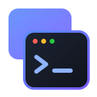
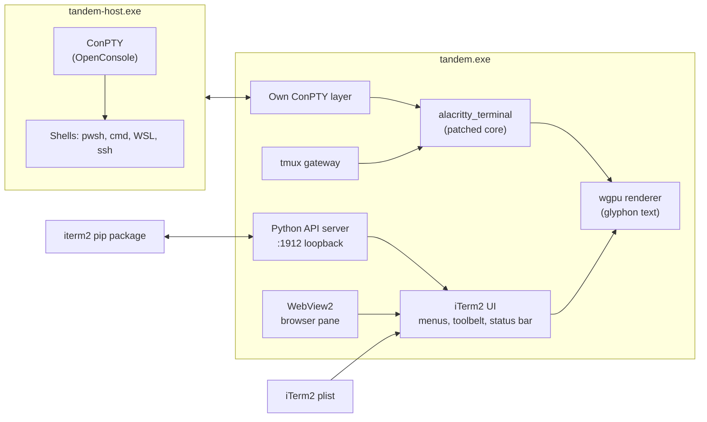

<div align="center">



# Tandem

**iTerm2, on Windows. All of it.**

A native Windows terminal, written in Rust, that aims at full 1:1 parity with iTerm2:
the same settings, the same menus, the same mouse, the same tmux integration, the same Python API.


[Why Tandem](#why-tandem) ·
[Features](#features) ·
[How it compares](#how-it-compares) ·
[Architecture](#architecture) ·
[Building](#building) ·
[Status](#status) ·
[Credits](#credits-and-licenses)

</div>

---

## Why Tandem

If you live in iTerm2 on a Mac, every Windows terminal feels like a step down. Some have tabs and
splits. A few have a drop-down window. None of them has tmux control mode, triggers, the toolbelt,
Instant Replay, or iTerm2's mouse.

Tandem does not borrow iTerm2's look. It ports iTerm2's behavior. Every profile setting, global
setting, menu item, and feature in iTerm2 is a row in a parity inventory, and each milestone closes
rows until they read `have`. Where iTerm2 has a quirk, Tandem keeps it and writes it down.

- **Your Mac settings, as they are.** Tandem reads iTerm2's own plist. Profiles, colors, keys,
  triggers, and arrangements come across without a conversion step.
- **Your scripts, unchanged.** The stock `iterm2` pip package connects to Tandem and works.
- **Your muscle memory.** iTerm2's menu bar, key actions, and pointer actions, with Win in place of Cmd.

## Features

<table>
<tr>
<td width="50%" valign="top">

### Terminal
- Native ConPTY sessions, with the current OpenConsole shipped beside the exe
- GPU renderer on wgpu, ligatures, box drawing, bidi, and true color
- Inline images: OSC 1337 File, sixel, the kitty graphics protocol, animated GIFs
- Every keyboard protocol: CSI u, modifyOtherKeys, and kitty flags with key releases
- Mouse reporting that works in vim, tmux, and htop, on WSL and native shells
- Sessions in `tandem-host.exe`, so shells outlive a crashed window

</td>
<td width="50%" valign="top">

### tmux integration
- `tmux -CC` control mode: tmux windows become real Tandem windows and tabs
- Pause and resume, the tmux dashboard, and option monitors
- Edits, moves, clipboard, client lists, and persistence
- The tmux status bar inside Tandem's own status bar

</td>
</tr>
<tr>
<td valign="top">

### Shell integration
- OSC 133 marks, OSC 7 directories, and the 1337 shell keys
- A PowerShell script, plus iTerm2's own installer for bash and zsh
- Command history, recent directories, prompt navigation, and alerts on finish
- Automatic Profile Switching by host, user, path, and job

</td>
<td valign="top">

### Triggers and automation
- Triggers in iTerm2's stored form, with every action iTerm2 lists
- Coprocesses, badges, Windows notifications, and idle and output alerts
- Broadcast input across panes, tabs, and windows
- Smart Selection and Semantic History, with all of their actions

</td>
</tr>
<tr>
<td valign="top">

### Windows and sessions
- Hotkey windows, including the drop-down style
- Window arrangements in iTerm2's plist form, plus restoration
- Every window style, Lock Size, Lock Layout, and Undo Close
- Tab groups, tab themes, pane title bars, transparency, and virtual desktops

</td>
<td valign="top">

### Tools
- The toolbelt with all twelve built-in tools
- Status bar with every component: clock, git, CPU, memory, network, and more
- The Composer, Open Quickly, Instant Replay, and Copy Mode
- Find, Find Globally, Filter, folds, annotations, and named marks

</td>
</tr>
<tr>
<td valign="top">

### Scripting
- iTerm2's Python API server, protocol 1.19, on the loopback only
- Script functions, the expression language, and the Scripts menu
- The Script Console and the Scripting Inspector
- `imgcat`, `it2dl`, `it2copy`, and the other utilities, built for Windows

</td>
<td valign="top">

### AI, SSH, and the browser
- AI chat, inline help, and the Cockpit, with Anthropic, Gemini, DeepSeek, and Ollama
- Claude Code integration through a `cc-status` hook
- iTerm2's SSH integration: the conductor, file transfers, and `ssh:` URLs
- A WebView2 browser pane with find, Copy Mode, marks, triggers, and reader mode
- A password manager on Windows Credential Manager, 1Password, and LastPass

</td>
</tr>
</table>

## How it compares

Tandem is the only Windows terminal we found that has the full iTerm2 set. The deciding feature
is native tmux control mode, which no other Windows terminal ships.

| | Hotkey window | Shell integration | Triggers | tmux `-CC` | Reads iTerm2 settings |
|---|:-:|:-:|:-:|:-:|:-:|
| Windows Terminal | Yes | Yes | No | No | No |
| WezTerm | With Lua | Yes | Partial | No | No |
| Tabby | Yes | Partial | No | No | No |
| Warp | Yes | Yes | No | No | No |
| **Tandem** | **Yes** | **Yes** | **Yes** | **Yes** | **Yes** |

## Architecture



- **Core.** `alacritty_terminal` 0.26 parses and stores the grid. Tandem carries a small set of
  patches for marks, row time, folds, image tiles, and blocks. Each patch is listed in
  `crates/alacritty_terminal/TANDEM-PATCHES.md`.
- **ConPTY.** Tandem has its own ConPTY code. The shipped `conpty.dll` and `OpenConsole.exe` load
  from beside the exe, never from the inbox console host by accident.
- **Safety.** Every program links the C runtime statically and loads its imports from System32
  only. Downloads, imports, and escape sequences that can act go through trust gates first.

## Building

Tandem builds on Windows with the MSVC Rust toolchain.

```powershell
# 1. Fetch the pinned ConPTY package (checked by SHA-256)
.\scripts\fetch-conpty.ps1

# 2. Build
cargo build --release

# 3. Run
.\target\release\tandem.exe
```

The build copies `conpty.dll` and `OpenConsole.exe` next to the exe. The browser pane needs the
WebView2 runtime, which Windows 10 and 11 normally have.

`.cargo/config.toml` sets `+crt-static`. The build stops if that flag is missing.

### Repository layout

| Path | What it holds |
|---|---|
| `src/` | The app, about 520 modules |
| `src/bin/` | `tandem`, `tandem-host`, `tandem-utils`, `tandem-git`, `cc-status`, and the probes |
| `crates/` | Patched copies of `alacritty_terminal`, `vte`, and `glyphon` |
| `resources/` | Shell integration, color presets, tab icons, terminfo, and AI prompts |
| `proto/`, `schema/` | iTerm2's API protocol and the settings schema |
| `docs/parity/` | The parity inventory: 1,797 rows across profile, global, and feature settings |
| `docs/acceptance/` | One hands-on checklist per milestone |
| `docs/superpowers/` | Specs, plans, and rulings for each milestone |
| `tests/` | Integration tests and fixtures |

## Status

Tandem started on 2026-09-23. It is near the end of the port.

| | |
|---|---|
| Milestones done | 0 to 12, 14, and 13a to 13x8 |
| Milestones left | AI browser tools, and a final gaps sweep |
| Tests | 6,338 |
| Rust | about 460,000 lines |
| Commits | about 1,970 |

The parity roadmap is in [`docs/parity/00-roadmap.md`](docs/parity/00-roadmap.md). Each
milestone has a checklist in [`docs/acceptance/`](docs/acceptance/) and a rulings file that lists
every kept iTerm2 quirk and every Windows-specific choice.

## Credits and licenses

Tandem stands on these projects:

- [iTerm2](https://github.com/gnachman/iTerm2) by George Nachman, the reference for every
  behavior. Files copied from iTerm2 (color presets, script templates, AI prompts, tips, and the
  utilities) are used under iTerm2's GPL v2 or later. See [`resources/LICENSE`](resources/LICENSE).
- [alacritty_terminal](https://github.com/alacritty/alacritty), [vte](https://github.com/alacritty/vte),
  and [glyphon](https://github.com/grovesNL/glyphon), under their own licenses in `crates/`.
- [Windows Terminal](https://github.com/microsoft/terminal) for ConPTY and OpenConsole.
  The notices are in `resources/conpty/`.

Tandem shows every bundled license at runtime, gathered at build time into one list.

<div align="center">
<sub>Built for people who miss iTerm2 every time they sit down at a Windows machine.</sub>
</div>
