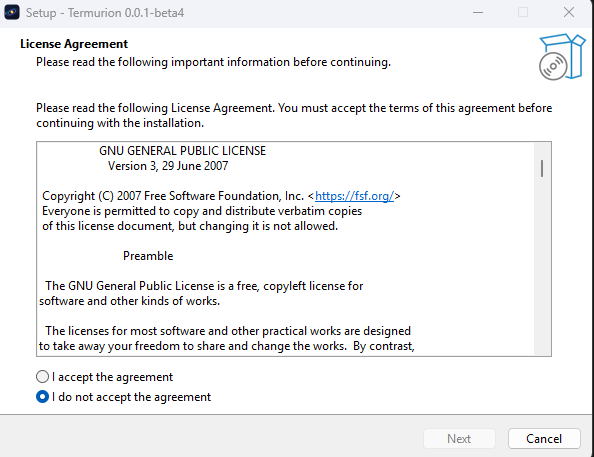
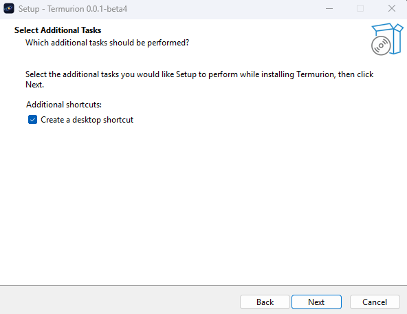
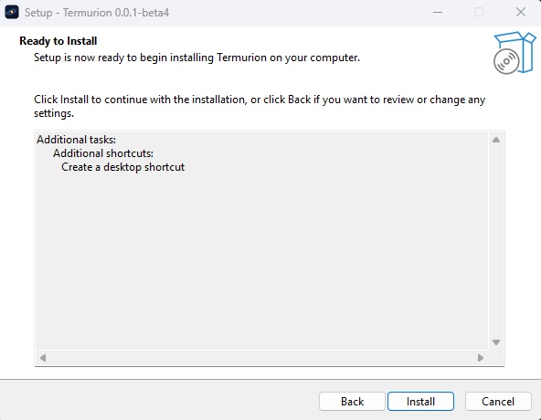
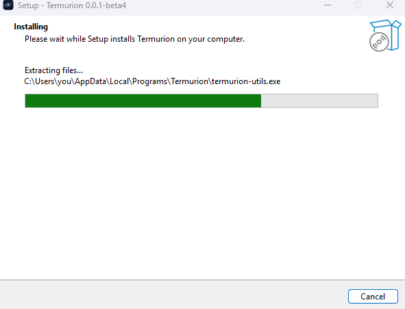
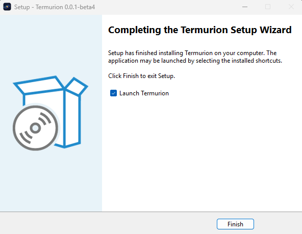

# Installing Termurion

Termurion runs on Windows 10 and 11 (x64). Download the newest beta from
[Releases](https://github.com/datbird/termurion/releases). There are two ways to run it.

## The installer

Run `Termurion-<version>-setup.exe`. It installs for your user only, so Windows does not ask for
admin rights. Files go to `%LOCALAPPDATA%\Programs\Termurion`.

The files are not code-signed yet. If Windows SmartScreen says the app is unrecognized, choose
More info, then Run anyway.

**1. License Agreement.** Termurion is under the GNU GPL v3 or later. Select "I accept the
agreement", then Next.



**2. Select Additional Tasks.** Leave "Create a desktop shortcut" on for a Desktop icon, or clear
it. The Start Menu entry is always made.



**3. Ready to Install.** Check your choices, then Install.



**4. Installing.** Setup copies the files.



**5. Completing the Termurion Setup Wizard.** Keep "Launch Termurion" on to start it now, then
Finish.



### Upgrades

Run the setup for the new version. It upgrades the install in place and keeps your settings. If
Termurion is running, Setup closes it first.

### Uninstall

Open Settings > Apps > Installed apps, find Termurion, and choose Uninstall. Your settings stay in
`%APPDATA%\Termurion`, and logs and crash reports in `%LOCALAPPDATA%\Termurion`. Delete those
folders too for a clean removal.

### Silent install

For scripts, Setup takes the usual Inno Setup options. For example:

```
Termurion-<version>-setup.exe /VERYSILENT /SUPPRESSMSGBOXES /NORESTART /TASKS=desktopicon
```

## The portable zip

Unzip `Termurion-<version>-windows-x64.zip` into any folder and run `termurion.exe`. Keep all the
files in the folder together: `conpty.dll` and `OpenConsole.exe` must stay beside the exe.
