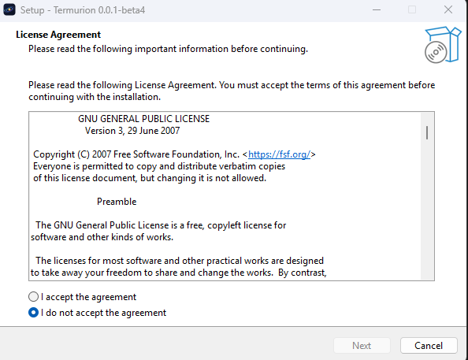
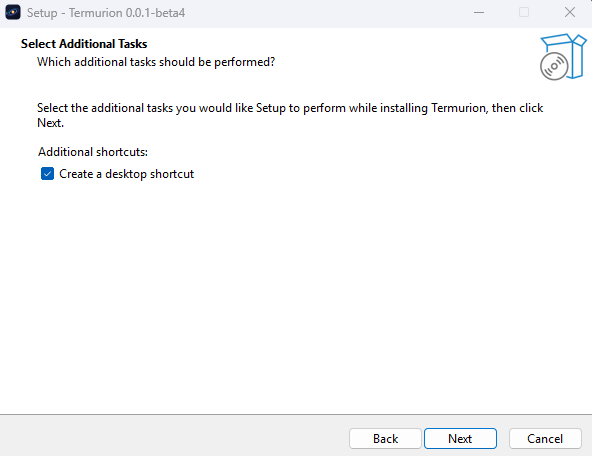
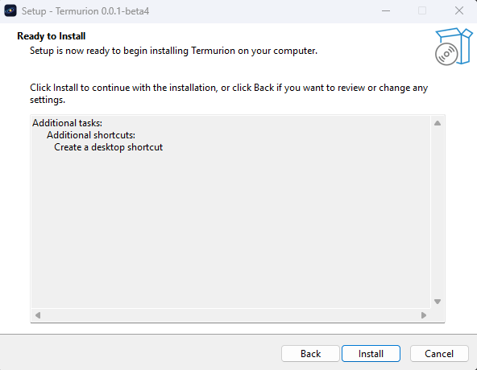
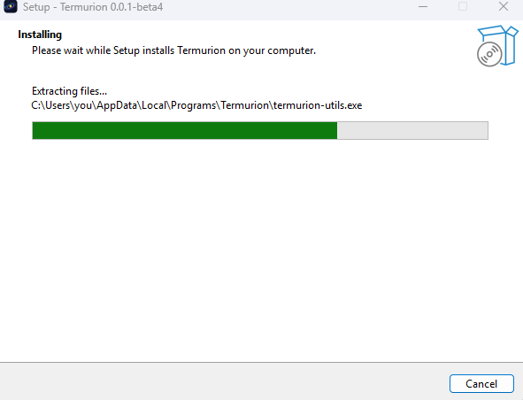
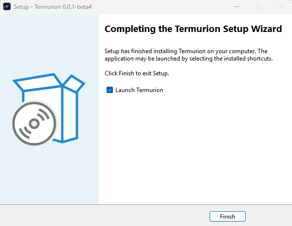

# Installing Termurion

Termurion 1.1.0 is the current stable release. It runs on Windows 10 and 11 (x64), on macOS (Apple
Silicon), and on Linux (x86_64). Download the file for your system from
[Releases](https://github.com/datbird/termurion/releases) (the 1.1.0 release is marked Latest).

| System | File |
|---|---|
| Windows installer | `Termurion-1.1.0-win64-installer.exe` |
| Windows portable | `Termurion-1.1.0-win64-portable.zip` |
| macOS (Apple Silicon) | `Termurion-1.1.0-macos-arm64.zip` |
| Linux (x86_64) | `Termurion-1.1.0-linux-x86_64.AppImage` |

## Windows

On Windows there are two ways to run Termurion: the installer and the portable zip. The files are
not code-signed yet. If Windows SmartScreen says the app is unrecognized, choose More info, then
Run anyway.

### The installer

Run `Termurion-1.1.0-win64-installer.exe`. It installs for your user only, so Windows does not ask for
admin rights. Files go to `%LOCALAPPDATA%\Programs\Termurion`.

**1. License Agreement.** Termurion is under the GNU GPL v3 or later. Select "I accept the
agreement", then Next.



**2. Select Additional Tasks.** Leave "Create a desktop shortcut" on for a Desktop icon, or clear
it. The Start Menu entry is always made.



**3. Ready to Install.** Check your choices, then Install.



**4. Installing.** Setup copies the files.



**5. Completing the Termurion Setup Wizard.** Keep "Launch Termurion" on to start it now, then
Finish.



#### Upgrades

Run the setup for the new version. It upgrades the install in place, including from a beta, and keeps your settings. If
Termurion is running, Setup closes it first.

#### Uninstall

Open Settings > Apps > Installed apps, find Termurion, and choose Uninstall. Your settings and the log file `host.log` stay in
`%APPDATA%\Termurion`, and crash reports and other local data in `%LOCALAPPDATA%\Termurion`. Delete those
folders too for a clean removal.

#### Silent install

For scripts, Setup takes the usual Inno Setup options. For example:

```
Termurion-1.1.0-win64-installer.exe /VERYSILENT /SUPPRESSMSGBOXES /NORESTART /TASKS=desktopicon
```

### The portable zip

Unzip `Termurion-1.1.0-win64-portable.zip` into any folder and run `termurion.exe`. Keep all the
files in the folder together: `conpty.dll` and `OpenConsole.exe` must stay beside the exe.

## macOS

Termurion needs an Apple Silicon Mac (arm64).

1. Download `Termurion-1.1.0-macos-arm64.zip` and unzip it.
2. Move `Termurion.app` to Applications.
3. Open it. The app is ad hoc signed and not notarized, so macOS blocks the first open.
4. Open System Settings > Privacy & Security, scroll down, and choose Open Anyway. Then open Termurion again.

The Shortcut Key is Cmd, as in iTerm2. Termurion has the native menu bar, the Dock icon, and
system-wide hotkeys. Passwords go in the macOS Keychain.

Your settings and the log file `host.log` are in `~/Library/Application Support/Termurion`. Other local
data is in `~/Library/Caches/Termurion`. To uninstall, drag `Termurion.app` to the Trash. Delete those two
folders too for a clean removal.

## Linux

Termurion needs an x86_64 computer with a desktop that runs X11 or Wayland. It was tested on
Ubuntu 26.04 with GNOME on Wayland. X11 also works.

1. Download `Termurion-1.1.0-linux-x86_64.AppImage`.
2. Make it executable: `chmod +x Termurion-1.1.0-linux-x86_64.AppImage`.
3. Run it. The first run adds Termurion to the app launcher with its icon.

The AppImage needs FUSE (`fusermount3`), which most desktops have. Where FUSE is missing, start it
with `--appimage-extract-and-run`.

On GNOME, with the AppIndicator extension that Ubuntu turns on, closing the last window keeps
Termurion running with its icon in the top bar. The icon's menu has New Window, the window list,
Settings, and Quit. A desktop with no tray quits when the last window closes. System-wide hotkeys
work on X11 only. Passwords go in the Secret Service (GNOME Keyring, KeePassXC, or KWallet).

Your settings and the log file `host.log` are in `~/.config/termurion` (or `$XDG_CONFIG_HOME/termurion`).
Other local data is in `~/.local/state/termurion` (or `$XDG_STATE_HOME/termurion`). To uninstall, delete the
AppImage and the launcher entry, `~/.local/share/applications/dev.termurion.Termurion.desktop`.
Delete the two folders too for a clean removal.

## What is not on macOS and Linux yet

Some features have no macOS or Linux backend yet. Where you use one, Termurion says "<feature> is
not available on <OS> yet". These include coprocesses, the browser pane, Dynamic Profiles,
printing, virtual desktops, launching Python API scripts, the Claude Code status hook
(`cc-status`), the terminal utilities, and 1Password and LastPass in the password manager. The full list and its status are in
[unix-test-gaps.md](../port/unix-test-gaps.md).
