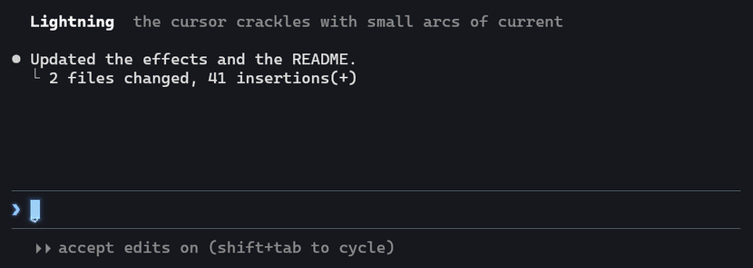

# Render plugins

Render plugins are shaders that run over the whole Termurion window every frame. Termurion
ships 13 cursor effects, and you can add your own.



[Full-size video](assets/render-plugins.mp4).

## Turn an effect on

1. Open **Settings > Profiles > Window**.
2. Under **Effects**, check one or more effects. Checked effects run in the order shown.
3. Use the arrows to change the order.

The setting is per profile. A window uses the effects of its focused pane's profile.

## The built-in effects

The 13 built-in effects come from
[ghostty-cursor-fx](https://github.com/Avarce/ghostty-cursor-fx) by AONIR (MIT license). They
are Aurora, Cyber, Embers, Fireworks, Glitch, Hologram, Katana, Lightning, Mecha, Neon,
Phosphor, Shockwave and Teleport.

Each effect is made for one cursor color (its `cursor_color`). Termurion gives that color to the
effect unless a program set its own cursor color.

## Claude Code: the Enter and done effects

The effects play when you send a prompt and when Claude finishes. Termurion makes both signals
itself, so nothing needs to be installed on the computer where Claude Code runs. This also
works over ssh and inside tmux:

- **Enter:** you press Enter.
- **Done:** output that kept coming for at least 1.5 seconds after Enter (Claude Code's spinner
  draws until the answer is in) stays quiet for 1.2 seconds. With shell integration, a long
  shell command's end (OSC 133;D) plays it at once.

Under **Effects**, the **Claude Code** group turns each part on or off: the Enter surge, the
done surge, the input box lines in the effect's color, input box lines that are always alive,
the prompt mark's look, and Termurion's own signals. The **General** group has the jump bolt and
the idle animation. These switches apply to every effect.

### Hooks (optional)

Claude Code hooks can send the signals instead. A hook's signal wins over Termurion's own.

On a Mac or Linux computer (also WSL, and any host you reach over ssh):

1. Copy `resources/render_plugins/hooks/fx-signal.sh` to `~/.termurion/fx-signal.sh`.
2. Merge `resources/render_plugins/hooks/claude-code-hooks.json` into `~/.claude/settings.json`.
3. In both commands, put your effect's `cursor_color` from its `plugin.toml`. Lightning's
   color is the default.

On Windows (Claude Code run natively):

1. Copy `resources/render_plugins/hooks/fx-signal.ps1` to `%USERPROFILE%\.termurion\`.
2. Merge `resources/render_plugins/hooks/claude-code-hooks-windows.json` into
   `%USERPROFILE%\.claude\settings.json`, with your user name in the paths.
3. Add the effect's color after `enter` and `done` (for example `enter "#ff5ed2"`) when it is
   not Lightning.

The script sets the cursor color with an invisible low-bit change (OSC 12), then resets it
(OSC 112) after 1.9 seconds. It finds the terminal through its parent processes, because a hook
has no terminal of its own. On Windows it attaches to `claude.exe`'s console. PowerShell takes
about a second to start, so the Enter effect plays about a second later on Windows.

Tested on 2026-10-31 with Claude Code on Linux over ssh, in WSL and on Windows. All show the
Enter surge, and the done surge where Claude answered.

## Write your own

Click **Open Effects Folder** in the Effects settings. Each effect is a folder:

```
my-effect/
  plugin.toml
  my-effect.glsl
```

`plugin.toml`:

```toml
name = "My Effect"
description = "What it does."
shaders = ["my-effect.glsl"]   # several files run in order
animation = "auto"             # auto, always or off
cursor_color = "#9fd0fe"       # optional
```

- `auto`: the window keeps redrawing for 2 seconds after the cursor moves or focus changes.
- `always`: the window redraws every frame while it has focus.
- `off`: the effect draws only when the terminal draws.

A folder with the same name as a built-in effect replaces the built-in one.

### GLSL (Ghostty and Shadertoy style)

Write `void mainImage(out vec4 fragColor, in vec2 fragCoord)`. Termurion gives the same uniforms
as Ghostty's custom shaders, so most Ghostty shaders run without changes:

| Uniform | Meaning |
|---|---|
| `iChannel0` | the terminal frame (use `texture(iChannel0, uv)`) |
| `iResolution` | window size in pixels |
| `iTime`, `iTimeDelta`, `iFrame` | time since the first frame, time since the last, frame count |
| `iCurrentCursor`, `iPreviousCursor` | x, y, width, height in pixels |
| `iCurrentCursorColor`, `iPreviousCursorColor` | the cursor colors, sRGB 0 to 1 |
| `iTimeCursorChange` | `iTime` when the cursor last moved or changed color |
| `iCurrentCursorStyle`, `iCursorVisible` | `CURSORSTYLE_BLOCK`, `_BLOCK_HOLLOW`, `_BAR`, `_UNDERLINE` |
| `iFocus`, `iTimeFocus` | 1 when the window has focus; `iTime` when focus came back |
| `iBackgroundColor`, `iForegroundColor`, `iCursorColor`, `iCursorText` | profile colors |
| `iSelectionBackgroundColor`, `iSelectionForegroundColor`, `iPalette[256]` | more colors |

Coordinates follow Ghostty on macOS (y goes down): `fragCoord` starts at the top left, and
`iCurrentCursor.y` is the bottom edge of the cursor. A Ghostty shader with a `Y_DOWN` switch
needs it set to `true`.

### WGSL

Write a fragment entry point named `fs_main` with these bindings:

```wgsl
@group(0) @binding(0) var iChannel0: texture_2d<f32>;
@group(0) @binding(1) var<uniform> u: Globals;   // the same members as the GLSL block
@group(0) @binding(2) var smp: sampler;

@fragment
fn fs_main(@builtin(position) p: vec4<f32>) -> @location(0) vec4<f32> {
    return textureSample(iChannel0, smp, p.xy / u.iResolution.xy);
}
```

### Settings in a shader

Lines like `const float SPEED = 1.5; // how fast` near the top of a shader are its settings.
Copy the effect's folder into the Effects folder and change them there.

### Errors

A shader that does not compile is left out, and a banner names the file and line.
